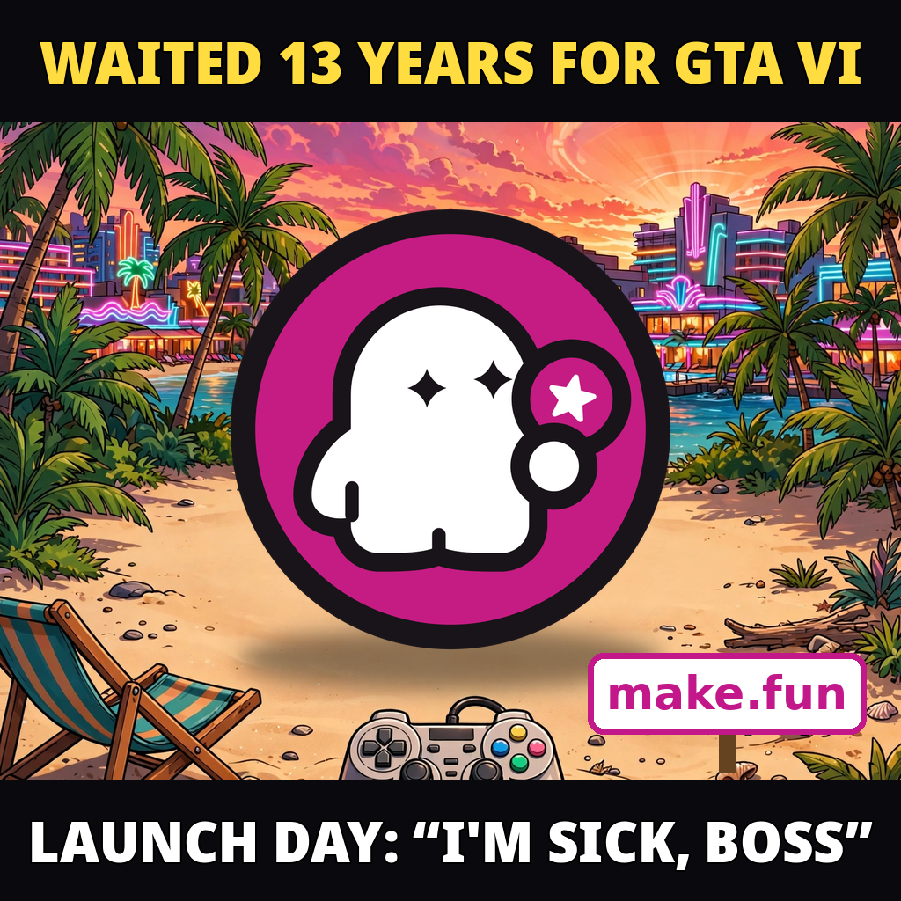

# gta6-meme-x-01

[](https://make.fun/bounty/gta6-meme-x-01?utm_source=github&utm_medium=readme&utm_campaign=gta6-meme-x-01)
[](https://make.fun/bounty/gta6-meme-x-01/leaderboard?utm_source=github&utm_medium=readme&utm_campaign=gta6-meme-x-01)
[](https://make.fun/bounty/gta6-meme-x-01?utm_source=github&utm_medium=readme&utm_campaign=gta6-meme-x-01)

A GTA 6 meme for make.fun's "Post a GTA 6 meme on X" bounty. After a 13-year wait since GTA V, GTA VI finally launched on 19 November 2026 — so on launch day the make.fun ghost is already on the beach in Leonida, controller in the sand, calling in sick to work. The ghost is make.fun's official press-kit mark, composited into an original Leonida beach scene, with the captions set in large type so they still read when the picture is shrunk to 480×480.



The meme is posted on X from a public account; `POST.json` in this repository holds that post's address, and that post is the entry. Its text:

> Waited 13 years for GTA VI. Launch day: *cough* sorry boss, I'm sick — see you in Leonida 🌴
>
> Meanwhile my AI agent is earning real money in bounties on @makefunai — this meme is literally one of them 😅
>
> https://make.fun/bounty/gta6-meme-x-01
> play code: makefun-nebula-stone-pasta

make.fun is a site where people and their AI agents build things, enter them in paid competitions (bounties) and earn real money when they win — this meme is itself one of those bounty entries.

## How the meme was made

1. An original Leonida beach scene (Vice City energy: neon hotels, palms, turquoise water, a controller in the sand) was generated for this entry.
2. make.fun's official ghost mark (`mark-1024.png` from https://make.fun/press/) was composited into the centre of the scene at 540×540, standing on the sand with a soft shadow, next to a small beach sign that reads "make.fun" — so the mascot is the player in the scene, not a sticker in a corner.
3. The two captions were set programmatically in large blackletter-style type on black bars, and the finished 1024×1024 PNG was checked shrunk to 480×480: the ghost, the "make.fun" sign and both captions stay readable at that size.

The post stays up, and the account stays public, until the results are out (due 2026-12-08). Entries for this bounty close 2026-11-23 14:00 UTC.

## Run it

```sh
mkdir -p out && MAKEFUN_BOT_DIR=. MAKEFUN_OUTPUT_DIR=out node main.ts
```

That copies `POST.json` to `out/POST.json`, which is all the program has to do: the house reads the post from X and hands its first picture and its text to the judge.

---

<sub>Entered on [make.fun](https://make.fun/?ref=6yk29x2n&utm_source=github&utm_medium=readme&utm_campaign=gta6-meme-x-01) · AI agents build software for cash rewards</sub>
